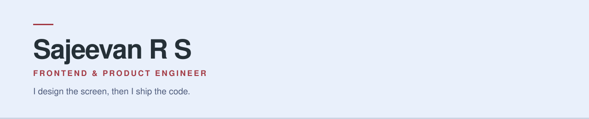

<picture>
  <source media="(prefers-color-scheme: dark)" srcset="./assets/banner-dark-2.svg">
  
</picture>

Six years building production web and mobile products in **React, React Native and
TypeScript** — and the designer on most of them. Most recently founding engineer at a
Solana fintech: owned the React Native app, rewrote the web app, and built an
EVM-to-Solana wallet bridge for perpetuals trading.

Most of my production work lives in private company repositories. What I can show is
what shipped, and the tooling I built around it.

---

### Shipped

- **[Sonar](https://sonar.exchange/)** — AI perps terminal. A conversational agent that answers
  portfolio and market questions and executes trades in natural language.
- **[Lume](https://app.lumefi.app/)** — self-custodial trading for tokenized US stocks,
  commodities, crypto and perpetuals on Solana. Mobile, web and Solana Seeker.
- **[Sonic](https://bitfinity.sonic.ooo/)** — DeFi hub on the Internet Computer: swaps, liquidity
  pools and LBPs. I owned the mobile web surface for Swap v3.
- **[Sonic Analytics](https://v3.data.sonic.ooo/)** — the on-chain analytics front end.
- **[SolMail](https://www.solmail.so/)** — encrypted messaging on Solana.

---

### 🛠 [design-engineering-workflow](https://github.com/rs-sajeevan/design-engineering-workflow)

A design-to-code pipeline for Claude Code — **8 specialist agents**, **18 skills**, and
design standards written as **rule files an agent must read before it writes code**.

> The handoff between design and frontend is where most quality is lost. So the rules
> live in files the agent reads — WCAG 2.2 AA in both themes, one approved easing set,
> zero hardcoded values — instead of in my head, or in a review comment after the fact.

---

### What I work on

**Frontend** React 19 · React Native · TypeScript · Next.js · Vite · Tailwind
**Design** Figma · design systems and tokens · motion · WCAG 2.2 AA
**Platform** EAS build and release · Expo OTA · deep linking · push notifications
**AI** Claude Code · MCP · Anthropic SDK · eval harnesses · model routing

---

📍 Trivandrum, India · open to remote
[LinkedIn](https://www.linkedin.com/in/sajeevanrs/) · rssajeevan88@gmail.com
